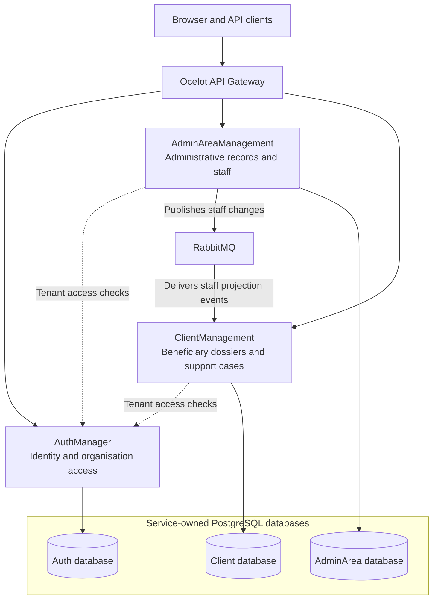

# Zeka Web API

Zeka’s .NET 8 backend provides identity and organisation access, administrative records, and beneficiary support. The Ocelot gateway routes HTTP requests to three service APIs. The solution also includes shared libraries, tests, database tools and deployment files.

## Architecture

## Repository guides

| Area | What it covers |
| --- | --- |
| [Ocelot API Gateway](ApiGateways/Ocelot.ApiGateway/README.md) | HTTP routing, browser transport and gateway configuration. |
| [AuthManager](Services/AuthManager/README.md) | Registration, browser sessions, token issuance, and organisation membership and permissions. |
| [AdminAreaManagement](Services/AdminAreaManagement/README.md) | Teams, staff, partners and documents, schools, training, and administrative reference data. |
| [ClientManagement](Services/ClientManagement/README.md) | Beneficiary lookup, dossiers, assessments, case assignments, interactions and follow-up actions. |
| [Deployments](Deployments/README.md) | Local build helpers, Kubernetes manifests and the [standalone M1 Compose stack](Deployments/local-stack/README.md). |
| [Database setup](Deployments/database/README.md) | PostgreSQL roles and conformance checks, with a separate [Auth migration guide](Services/AuthManager/AuthManager.Infrastructure/Migrations/README.md). |
| [Owner provisioning](Tools/Zeka.AuthOwnerProvision/README.md) | The private Windows tool for first-administrator provisioning on the approved isolated stack. |
| [C1 failure ratchet](scripts/ci/c1-ratchet/README.md) | CI comparison of named test results against the trusted baseline. |

For local package restore and CI details, see [Private package restore](Docs/security/private-package-restore.md) and [MVP pull-request validation](Docs/ci/mvp-pr-validation.md).

## Root files

| File | Purpose |
| --- | --- |
| [`.dockerignore`](.dockerignore) | Excludes generated outputs, local environment files and other inputs from Docker build contexts. |
| [`.gitignore`](.gitignore) | Keeps generated build outputs, editor files and selected local configuration out of Git. |
| [`AGENTS.md`](AGENTS.md) | Sets repository engineering, architecture, security and verification rules. |
| [`Directory.Build.props`](Directory.Build.props) | Selects the Linux x64 NuGet lockfile for restores using that runtime contract. |
| [`LICENSE`](LICENSE) | Contains the GNU Affero General Public License, version 3. |
| [`README.md`](README.md) | Explains the repository layout, architecture and root files. |
| [`docker-compose.dcproj`](docker-compose.dcproj) | Defines the Visual Studio Linux Docker Compose project and its launch settings. |
| [`docker-compose.override.yml`](docker-compose.override.yml) | Applies local environment and port overrides to the gateway in the root Compose stack. |
| [`docker-compose.yml`](docker-compose.yml) | Defines the legacy root Compose stack with the gateway, RabbitMQ and PostgreSQL. |
| [`global.json`](global.json) | Pins the .NET SDK version and roll-forward policy. |
| [`launchSettings.json`](launchSettings.json) | Defines the solution-level Visual Studio Docker Compose launch profile. |
| [`nuget.config`](nuget.config) | Declares NuGet.org and GitHub Packages as package sources. |
| [`zeka-web-api.sln`](zeka-web-api.sln) | Groups the gateway, service, shared library, tooling and test projects, and the Compose project. |
